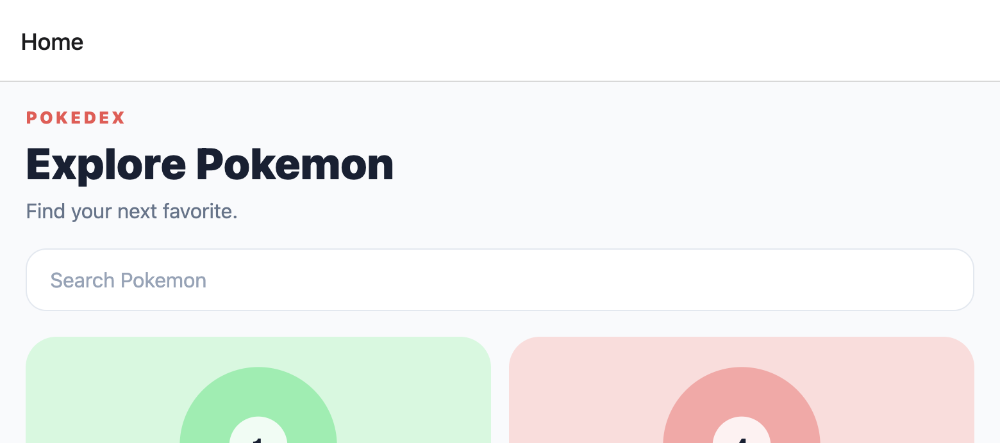

# Pokedex App

A mobile-first Pokedex built with Expo, React Native, TypeScript, and Expo Router. It uses the PokeAPI to display Pokemon in a searchable card grid and provides a focused details screen with four content tabs.



## Features

- Search Pokemon by name or type.
- Browse Pokemon cards with type-based colors.
- Open a details screen for each Pokemon.
- View four details tabs: About, Base Stats, Evolution, and Moves.
- Show loading and API error states.
- Reuse shared components and typed API data across screens.

## Tech Stack

- Expo SDK 57
- React Native 0.86
- Expo Router
- TypeScript
- Jest and React Native Testing Library
- [PokeAPI](https://pokeapi.co/)

## Getting Started

Install dependencies:

```bash
npm install
```

Start the development server:

```bash
npx expo start
```

Then open the app in Expo Go, an iOS simulator, an Android emulator, or the web browser.

## Commands

```bash
npm run ios             # Start the iOS target
npm run android         # Start the Android target
npm run web             # Start the web target
npm test -- --runInBand # Run component tests
npx tsc --noEmit        # Run TypeScript validation
npx expo lint           # Run Expo lint when ESLint is configured
```

## Project Structure

```text
src/
  app/
    _layout.tsx          Expo Router stack
    index.tsx            Searchable Pokemon list
    details.tsx          Pokemon details route
  components/
    PokemonCard.tsx      Reusable list card
    PokemonDetailsView.tsx
    SearchBar.tsx
    TypeBadge.tsx
  constants/
    pokemon.ts           Type color palette
  services/
    pokemonApi.ts        PokeAPI requests and mapping
  types/
    pokemon.ts           Shared Pokemon models
```

## Testing

Component tests live in `src/components/__tests__`. They cover rendering, user interaction, navigation callbacks, and all four details tabs.

The API requires network access at runtime. If the device or emulator cannot reach `pokeapi.co`, the app shows its loading or error state instead of local fallback data.
